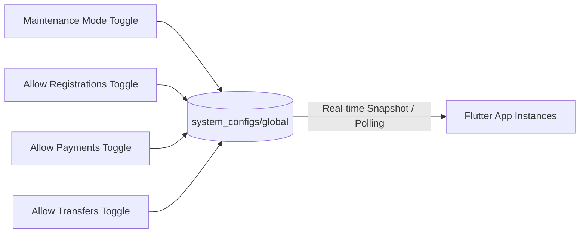

# VendSoft Admin Panel & Operational Command Blueprint (Version 1.0 Frozen)

## 1. Portal Architecture & Role-Based Access Control (RBAC)

The **VendSoft Admin Panel** (`https://admin.vendsoft.app`) is a secure, lightweight web portal built with **React / Next.js / Flutter Web** hosted on Cloudflare Pages and protected by **Cloudflare Zero Trust Access (SAML / SSO / MFA)**. 

### 1.1 Simple Operational Roles (`Version 1.0 Frozen`)
To minimize administrative complexity, the portal implements a simple two-tier access hierarchy:

| Role Name | Authentication & Security | Permitted Operations & Capabilities |
| :--- | :--- | :--- |
| **Support / Admin** | Cloudflare Access + Two-Factor Authentication (2FA) | • **Manage Global System Configurations (`system_configs/global`)**: Toggle `maintenanceMode`, `allowRegistrations`, `allowPayments`, and `allowTransfers`<br/>• Search customers by `customerId`, `mobileNumber`, `ownerName`, or `businessName`<br/>• View customer profile, subscription status, payment history, and installation history<br/>• View the current active device (`activeInstallationId`)<br/>• **Approve manual transfer (`Lost or Broken Phone Case`)**<br/>• **Change `mobileNumber` and `businessName` (metadata only without breaking subscriptions)**<br/>• Suspend / Ban customer accounts (`cus_xxxxxxxxx`) and hardware IDs (`deviceId`)<br/>• Extend subscription duration (`+7d`, `+30d`, `+365d`)<br/>• Upgrade / Downgrade subscription plans (`DEMO_FREE` <-> `PRO_YEARLY`)<br/>• View and filter real-time `audit_logs` |

---

## 2. Comprehensive Operational & UI Capabilities

### 2.1 Global System Configurations Controller (`system_configs/global`)
Allows Support Admins to control global server behavior directly from the dashboard header without requiring code deployments.



- **Maintenance Mode Lock**: Turning on `maintenanceMode` instantly blocks cloud checks and registration across all active app instances, displaying `maintenanceMessage` while letting vendors bill offline locally.
- **Feature Switches**: Toggle individual capabilities (`allowRegistrations`, `allowPayments`, `allowTransfers`) during gateway maintenance or promotional events.

---

### 2.2 Customer Search & 360° Profile Inspector
The primary workspace for customer support and account management.

```mermaid
graph TD
    Search[Multi-Field Search Bar<br/>customerId / mobileNumber / businessName] --> Profile[Customer Profile View<br/>cus_xxxxxxxxx (Immutable)]
    Profile --> EditMeta[Edit Metadata Modal<br/>Change Business Name or Mobile Number]
    Profile --> SubTab[Subscription Inspector<br/>Plan / Validity / Active Installation]
    Profile --> InstTab[Installation History Table<br/>inst_xxxxxxxxx / hardwareId / uuid]
    Profile --> PayTab[Payment Ledger Table<br/>order_xxxxxxxxx / Razorpay status]
    Profile --> TransferTab[Pending Transfer Queue<br/>Approve Manual Transfer Action]
```

#### Search & Navigation
- **Universal Search**: Live query resolution against `customerId` (`cus_xxxxxxxxx`), `mobileNumber` (`+919876...`), `ownerName`, `businessName`, or `razorpay_order_id`.
- **Customer Profile Overview**: Displays immutable `customerId`, editable `businessName`, editable `mobileNumber`, account onboarding date, and account status (`ACTIVE`, `SUSPENDED`, `BANNED`).

#### One-Click Metadata Editing (`businessName` & `mobileNumber`)
Because `customerId` (`cus_xxxxxxxxx`) is the sole primary identifier, Support Admins can click **"Edit Contact Profile"** to update `businessName` (`"Sharma Newspaper Agency"` -> `"Sharma & Sons News Depot"`) or `mobileNumber` (`"+919876543210"` -> `"+919988776655"`). The update writes to `/customers/cus_xxxxxxxxx` instantly **without invalidating any active subscription or `signedLeaseToken`**.

---

### 2.3 Active Device (`activeInstallationId`) & Installation History
Allows support engineers to inspect all hardware associated with a customer account and resolve device conflicts.

#### Installation History Table
`Installation ID` | `Hardware ID (getDeviceId)` | `Installation UUID` | `Platform & OS` | `App Version` | `Status` | `Last Heartbeat`

- **Visual Highlighting**: The single installation row matching `subscriptions.activeInstallationId` is highlighted in vibrant green with an **"ACTIVE DEVICE"** badge. All other rows display grey `"SUPERSEDED"` badges.
- **Hardware Ban Action**: Clicking "Ban Device" sets `isBanned = true` on `installations/inst_xxxxxxxxx` and blacklists the 16-char `hardwareId` across the edge router (`AuthGuard`).

---

### 2.4 Manual Transfer Approval (`Lost or Broken Phone Recovery`)
The **ONLY** manual recovery flow permitted when a customer loses or destroys their old phone (`inst_OLD`) and cannot execute peer-to-peer polling/approval.

#### Workflow & Safety Interface
1. **Pending Transfer Alert**: When searching for `cus_xxxxxxxxx`, if a transfer request (`trn_xxxxxxxxx`) is pending where `status == "PENDING"`, a prominent orange alert banner displays: *"Transfer Request Pending from inst_NEW_PHONE (Requested 3 hours ago)"*.
2. **Identity Verification Gate**: The Support Admin verifies the customer's identity over the phone using billing invoice numbers, bank transaction references, or agency registration details.
3. **Approve Manual Transfer Button**: Clicking **"Approve Manual Transfer"** opens a confirmation modal requiring mandatory internal justification notes (e.g., `"Customer lost Samsung S21 in transit; verified via UPI transaction ID 4059123"`).
4. **Authoritative Execution**: The portal invokes `POST /api/v1/admin/transfers/approve`. The Worker atomically:
   - Sets `subscriptions.activeInstallationId = trn.newInstallationId`
   - Sets `installations/oldInstallationId.status = "REVOKED"`
   - Sets `installations/newInstallationId.status = "ACTIVE"`
   - Sets `device_transfers/trn.status = "APPROVED"` (`approvedBy = "ADMIN_MANUAL"`)
   - Writes an immutable record to `audit_logs`.

---

### 2.5 Subscription Extension & Tier Management
Allows admins to handle billing adjustments, goodwill extensions, and offline cash subscriptions directly.

#### Capabilities
- **Extend Subscription Duration**: Clicking "Extend Validity" opens a modal to add `+7 days` (grace extension), `+30 days` (monthly courtesy), or `+365 days` (annual renewal for cash/cheque settlement). The Worker atomically increments `subscriptions.expiresAt` and re-signs the cryptographic lease (`signedLeaseToken`).
- **Upgrade / Downgrade Plan**: Switch `planId` instantly between `DEMO_FREE`, `PRO_MONTHLY`, and `PRO_YEARLY`.
- **Suspend / Ban Customer**: Toggle account `status = "SUSPENDED"` (temporarily locks access due to billing dispute) or `"BANNED"` (permanent lockout for fraud).

---

### 2.6 Real-Time Security Audit Logs Inspector
Displays a live feed of all system anomalies, transfer approvals, and security alerts from `audit_logs`.

#### Data Grid Columns
`Timestamp` | `Severity` | `Event Type` | `Customer ID` | `Target Installation` | `Metadata & Justification` | `Action Taken By`

- **Filter Toggles**: Filter strictly by `CLOCK_DISCREPANCY_DETECTED`, `WEBHOOK_SIGNATURE_INVALID`, `TRANSFER_APPROVED_ADMIN`, or `INSTALLATION_REVOKED`.
- **Audit Transparency**: Ensures complete accountability across all support staff by tracking exact Admin User IDs alongside every manual transfer approval or validity extension.
