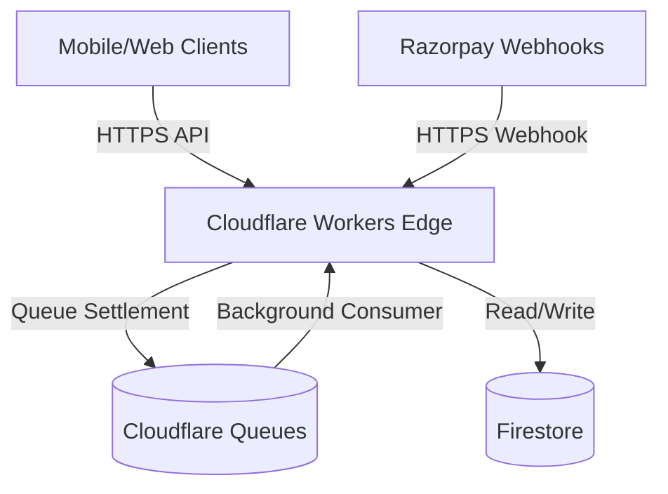
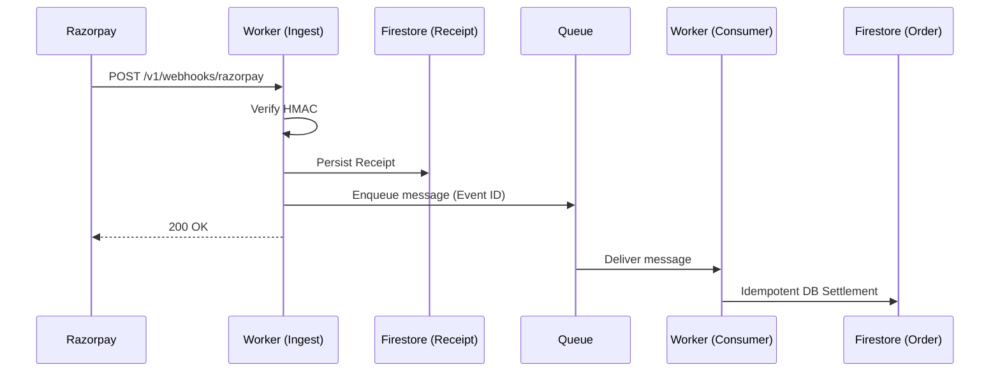

# VendSoft v1 Architecture

This document serves as the canonical reference for the VendSoft backend architecture (v1), which evolved across ten major engineering phases to become a secure, scalable, and fully observable cloud-native control plane.

---

## 1. Top-Level Topology

The system executes entirely on Cloudflare Workers (serverless V8 isolates). There are no long-running node processes.

---

## 2. Request Flow Pipeline

Every synchronous HTTPS request passes through a hardened request pipeline before reaching business logic:

1. **Context Initialization**: A unique trace ID is generated, and `RequestContext` is instantiated.
2. **Global Security Headers**: `Strict-Transport-Security`, `Content-Security-Policy`, etc.
3. **Authentication Guard**: Verifies Bearer tokens (or HMACs for webhooks).
4. **Rate Limiting**: Enforces token-bucket rate limiting via Cloudflare KV caching.
5. **RBAC Guard (Admin)**: Explicit authorization matrix verification against the caller's role.
6. **Controller Execution**: The specific domain logic is executed.
7. **Telemetry Tracking**: Latency, status codes, and trace context are recorded asynchronously.

---

## 3. Webhook & Asynchronous Queue Flow

To ensure high availability against upstream outages, webhook ingestions are strictly decoupled from order settlement.

If the database write fails during settlement, `message.retry()` is invoked, deferring exponential backoff to the Cloudflare Queue infrastructure.

---

## 4. Resilience Model

We treat the database and third-party APIs as untrusted/volatile infrastructure. 
The system relies on pluggable resilience primitives stored in `src/services/resilience/`:

* **Circuit Breakers**: In-memory, isolate-local breakers that fail-fast when downstream error thresholds are exceeded.
* **Timeouts**: Strict latency budgets (e.g., maximum 5s for an external Razorpay API call).
* **Retry Interceptors**: Operation-aware retry logic (idempotent reads vs. non-idempotent writes).

*Reference: `docs/RESILIENCE_REGISTRY.md`*

---

## 5. Security & Authorization

VendSoft uses a fail-closed authorization model. 
* There is no implicit "admin" fallback.
* Every administrative route explicitly maps to a granular permission (e.g., `audit:read`, `users:write`).
* Security headers and API keys are validated aggressively.

*Reference: `docs/SECURITY_RULES.md` and `docs/AUTHORIZATION_MATRIX.md`*

---

## 6. Observability & Diagnostics

We adhere strictly to "measure before optimizing."
* Every log line includes a structured `traceId`.
* Integration latency is published as metrics.
* A dedicated `GET /v1/admin/diagnostics` endpoint executes active probes against downstream dependencies to assess system health dynamically.

*Reference: `docs/PERFORMANCE_DASHBOARD.md`*

---

## 7. Data Lifecycle & Background Jobs

Cron Triggers run asynchronously to purge expired data based on centralized Retention Policies:
* 30 days for Webhook Receipts.
* 90 days for Audit Logs.
* 7 days for Diagnostic metrics.

---

## 8. Deployment & CI/CD Topology

Deployments are fully automated via GitHub Actions (`.github/workflows/`), promoting code through environments:

1. **Quality Gate**: Linting, TypeScript compilation, and Vitest suite execution on PRs.
2. **Staging Deploy**: Triggered automatically on push to `main` (mapped to `staging-api.vendsoft.com`).
3. **Production Deploy**: Triggered exclusively via formal GitHub Releases (mapped to `api.vendsoft.com`).

*Environments maintain strict namespace isolation via distinct KV bindings, Queues, and Firestore Projects.*

---

## 9. Future Roadmap

As usage grows, the engineering roadmap focuses on operational metrics:
- Exposing **Dead-Letter Queue (DLQ)** management tooling for webhook replay.
- Expanding **Capacity Planning** dashboards targeting Queue latency and Firestore read/write rates.
- Evolving into **Feature Development** now that foundational isolation boundaries are established.
