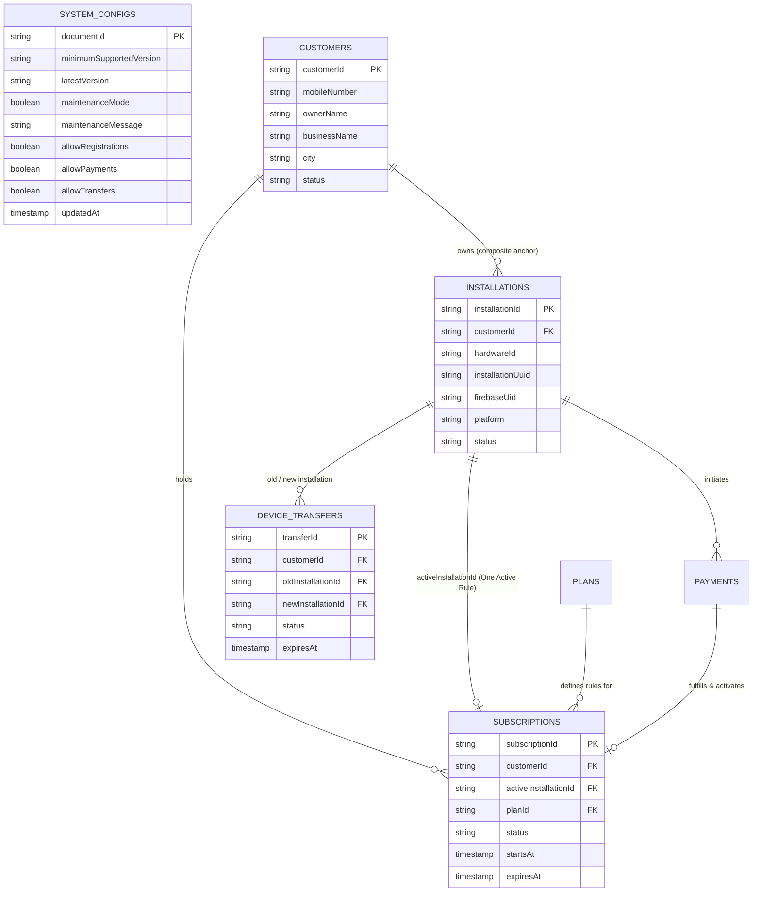

# Cloud Firestore Schema & Data Modeling Blueprint (Version 1.0 Frozen)

## 1. Schema Design Philosophy & Naming Conventions

The Firestore database for VendSoft is designed exclusively for **Control Plane Metadata, Composite Identity Tracking, Licensing Enforcement, Global System Configuration, and Audit Trailing**. No end-user business records (such as customer lists, daily delivery checks, or receipt images) are ever saved in this database.

### Core Naming & Structural Conventions
1. **Collection Names**: Always **lowercase, plural nouns** (`system_configs`, `plans`, `customers`, `installations`, `subscriptions`, `payments`, `device_transfers`, `audit_logs`, `idempotency_keys`).
2. **Document IDs**:
   - For system configuration: Exact document ID `global` inside `/system_configs/`.
   - For customers: Cloudflare-generated immutable prefix identifiers (`cus_xxxxxxxxx`).
   - For installations: Cloudflare-generated prefix identifiers (`inst_xxxxxxxxx` or matching `installationUuid`).
   - For subscriptions: Cloudflare-generated prefix identifiers (`sub_xxxxxxxxx`).
   - For transfers: Cloudflare-generated prefix identifiers (`trn_xxxxxxxxx`).
   - For payments: Exact `razorpay_order_id` (`order_xxxxxxxxx`) enforcing 1:1 idempotency.
3. **Field Naming**: Always `camelCase` (`customerId`, `activeInstallationId`, `minimumSupportedVersion`, `createdAt`).
4. **Timestamps**: Always stored as Firestore `Timestamp` types (`FieldValue.serverTimestamp()`). Never store timestamps as strings or client integers to eliminate clock spoofing.
5. **Soft Deletions & Statuses**: Records are never permanently deleted from transactional collections. Status fields (`ACTIVE`, `EXPIRED`, `REVOKED`, `PENDING`, `APPROVED`, `REJECTED`) govern access while preserving absolute historical auditability.

---

## 2. Entity Relationship Diagram (ERD)

---

## 3. Detailed Collection Specifications

### 3.1 `system_configs` Collection (Global Server Configuration)
Holds the server-controlled configuration object. **Managed strictly by Cloudflare Workers and the Admin Panel. The Flutter client application must only read (`GET /api/v1/config/system` or read-only `system_configs/global`) and must never write (`Allow write: if false`).**

*Document ID*: Exactly `global` (`/system_configs/global`)

| Field Name | Data Type | Required | Default / Constraints | Description |
| :--- | :--- | :--- | :--- | :--- |
| `minimumSupportedVersion`| `string`| Yes | e.g., `"1.0.0+1"` | Semantic build version below which the app forces an update modal. |
| `latestVersion` | `string` | Yes | e.g., `"1.0.2+3"` | Current target release version. |
| `maintenanceMode` | `boolean`| Yes | `false` | If true, cloud operations lock cleanly while offline billing continues. |
| `maintenanceMessage` | `string` | Yes | Descriptive string | Message displayed inside the app during server maintenance. |
| `allowRegistrations` | `boolean`| Yes | `true` | Dynamic switch to enable/disable new customer onboarding. |
| `allowPayments` | `boolean`| Yes | `true` | Dynamic switch to enable/disable Razorpay checkout initiation. |
| `allowTransfers` | `boolean`| Yes | `true` | Dynamic switch to enable/disable peer-to-peer transfer initiation. |
| `updatedAt` | `timestamp`| Yes | `serverTimestamp()`| Last modification timestamp by system administrators. |

---

### 3.2 `customers` Collection (Immutable Business Profiles)
Represents the registered business owner. **`customerId` is the sole immutable primary key (`cus_xxxxxxxxx`). Business Name and Mobile Number are display/contact metadata only and may be edited at any time without disrupting subscriptions.**

*Document ID Example*: `cus_89A2B3C4D5`

| Field Name | Data Type | Required | Default / Constraints | Description |
| :--- | :--- | :--- | :--- | :--- |
| `customerId` | `string` | Yes | Exact match to Document ID | Immutable supreme account identifier generated by Cloudflare (`cus_xxxxxxxxx`). |
| `mobileNumber` | `string` | Yes | E.164 format (`+919876543210`) | Editable primary contact number. **Not a primary key.** |
| `ownerName` | `string` | Yes | e.g., `"Rajesh Sharma"` | Editable name of the agency owner. |
| `businessName` | `string` | Yes | e.g., `"Sharma Newspaper Agency"` | Editable agency/vendor display name. **Not an identifier.** |
| `city` | `string` | No | e.g., `"Lucknow"` \| `null` | Optional city name collected on onboarding. |
| `status` | `string` | Yes | `"ACTIVE"` \| `"SUSPENDED"` \| `"BANNED"` | Account-level status governing all linked installations. |
| `notes` | `string` | No | `null` | Internal administrative remarks. |
| `createdAt` | `timestamp` | Yes | `serverTimestamp()` | Account onboarding timestamp. |
| `updatedAt` | `timestamp` | Yes | `serverTimestamp()` | Last profile modification timestamp. |

---

### 3.3 `installations` Collection (Hardware & Storage Telemetry)
Tracks every physical device or app instance registered to a `customerId`. Implements the **Composite Identity Model** (`hardwareId` + `installationUuid` + `firebaseUid`).

*Document ID Example*: `inst_44E5F6A7B8` (or exact `installationUuid`)

| Field Name | Data Type | Required | Default / Constraints | Description |
| :--- | :--- | :--- | :--- | :--- |
| `installationId` | `string` | Yes | Exact match to Document ID | Unique installation primary key (`inst_xxxxxxxxx`). |
| `customerId` | `string` | Yes | Foreign Key -> `customers` | The business profile owning this installation. |
| `hardwareId` | `string` | Yes | 16-char hex string | `LicenseService().getDeviceId()` (SHA-256 of `ANDROID_ID`). Preserved for backward compatibility. |
| `installationUuid`| `string` | Yes | UUID v4 string | Persistent UUID stored inside `FlutterSecureStorage`. Eliminates `UNKNOWN_DEVICE` collisions. |
| `firebaseUid` | `string` | Yes | Firebase Auth UID (28 chars) | Current Anonymous or Authenticated Firebase Auth session UID. |
| `platform` | `string` | Yes | `"android"` \| `"windows"` | Operating system platform. |
| `appVersion` | `string` | Yes | e.g., `"1.0.0+1"` | Semantic build version. |
| `deviceModel` | `string` | No | e.g., `"Samsung SM-M315F"` | Hardware model string. |
| `status` | `string` | Yes | `"ACTIVE"` \| `"REVOKED"` \| `"SUPERSEDED"` | Status of this specific installation instance. |
| `isBanned` | `boolean` | Yes | `false` | If true, Workers refuse all requests from this hardware ID or UUID. |
| `createdAt` | `timestamp` | Yes | `serverTimestamp()` | Registration timestamp. |
| `lastSeenAt` | `timestamp` | Yes | `serverTimestamp()` | Updated periodically by heartbeat checks. |

---

### 3.4 `subscriptions` Collection (The One Active Device Ledger)
The authoritative ledger of all entitlement grants. Enforces the **One Active Device Rule**: a subscription is valid ONLY when queried by the installation matching `activeInstallationId`.

*Document ID Example*: `sub_77F8E9A0B1`

| Field Name | Data Type | Required | Default / Constraints | Description |
| :--- | :--- | :--- | :--- | :--- |
| `subscriptionId` | `string` | Yes | Exact match to Document ID | Unique subscription grant identifier (`sub_xxxxxxxxx`). |
| `customerId` | `string` | Yes | Foreign Key -> `customers` | The business account owning this entitlement. |
| `activeInstallationId`| `string`| Yes | Foreign Key -> `installations` | **The Single Active Installation (`inst_xxxxxxxxx`) currently authorized to use this subscription.** |
| `planId` | `string` | Yes | Foreign Key -> `plans` | Entitlement tier (`DEMO_FREE`, `PRO_YEARLY`). |
| `status` | `string` | Yes | `"ACTIVE"` \| `"EXPIRED"` \| `"REVOKED"` | Current state of this subscription grant. |
| `startsAt` | `timestamp` | Yes | `serverTimestamp()` | Exact UTC second when validity period began. |
| `expiresAt` | `timestamp` | Yes | `startsAt + durationDays` | Exact UTC second when validity period ends. |
| `paymentId` | `string` | No | Foreign Key -> `payments` \| `null` | Linked transaction ID (`order_xxxxxxxxx`). |
| `signedLeaseToken`| `string` | Yes | Base64 Encoded Signed JSON | Cryptographic lease signed by Worker RSA/Ed25519 private key. |
| `createdAt` | `timestamp` | Yes | `serverTimestamp()` | Record creation timestamp. |
| `updatedAt` | `timestamp` | Yes | `serverTimestamp()` | Last modification timestamp. |

---

### 3.5 `device_transfers` Collection (Peer-to-Peer & Admin Transfer Requests)
Manages device migrations securely without paid SMS verification. Enforces strict safety rules: **only 1 pending transfer allowed per subscription, expires precisely after 24 hours (`serverTimestamp() + 24 hours`), and requires explicit Old Device or Admin approval.**

*Document ID Example*: `trn_12A3B4C5D6`

| Field Name | Data Type | Required | Default / Constraints | Description |
| :--- | :--- | :--- | :--- | :--- |
| `transferId` | `string` | Yes | Exact match to Document ID | Unique transfer request identifier (`trn_xxxxxxxxx`). |
| `subscriptionId` | `string` | Yes | Foreign Key -> `subscriptions` | The active subscription being requested for transfer. |
| `customerId` | `string` | Yes | Foreign Key -> `customers` | The account owning the subscription. |
| `oldInstallationId`| `string`| Yes | Foreign Key -> `installations` | The current `activeInstallationId` that must approve the transfer via **polling or optional push notification**. |
| `newInstallationId`| `string`| Yes | Foreign Key -> `installations` | The requesting target installation (`inst_xxxxxxxxx`). |
| `status` | `string` | Yes | `"PENDING"` \| `"APPROVED"` \| `"REJECTED"` \| `"EXPIRED"` \| `"REVOKED"` | Lifecycle state of the transfer request. |
| `approvedBy` | `string` | No | `"PEER_OLD_DEVICE"` \| `"ADMIN_MANUAL"` \| `null` | Records who authorized the transfer. |
| `adminId` | `string` | No | Admin Account ID \| `null` | Admin user ID if manually approved via Admin Panel. |
| `expiresAt` | `timestamp` | Yes | `serverTimestamp() + 24 hours` | Strict 24-hour expiration window. |
| `createdAt` | `timestamp` | Yes | `serverTimestamp()` | Request initiation timestamp. |
| `completedAt` | `timestamp` | No | `serverTimestamp()` \| `null` | Timestamp when transfer was approved or rejected. |

---

### 3.6 `plans` Collection (Catalog Definitions)
*Document ID Example*: `PRO_YEARLY`

| Field Name | Data Type | Required | Default / Constraints | Description |
| :--- | :--- | :--- | :--- | :--- |
| `planId` | `string` | Yes | Immutable (`DEMO_FREE`, `PRO_MONTHLY`, `PRO_YEARLY`) | Unique tier code matching document ID. |
| `name` | `string` | Yes | e.g., `"Pro Annual License"` | Display title. |
| `priceInr` | `number` | Yes | `>= 0` (e.g., `1499`) | Exact integer price in Indian Rupees. |
| `durationDays` | `number` | Yes | `30`, `365`, `36500` | Validity period in calendar days. |
| `maxCustomers` | `number` | Yes | `50`, `1000`, `10000` | Maximum customer rows permitted in local Excel. |
| `isActive` | `boolean` | Yes | `true` | Whether visible in checkout modal. |

---

### 3.7 `payments` Collection (Financial Transaction Ledger)
*Document ID Example*: `order_K8s9Dk29sK` (`razorpay_order_id`)

| Field Name | Data Type | Required | Default / Constraints | Description |
| :--- | :--- | :--- | :--- | :--- |
| `paymentId` | `string` | Yes | Exact match to Document ID | Primary transaction tracking ID (`razorpay_order_id`). |
| `razorpayOrderId` | `string` | Yes | e.g., `"order_K8s9Dk29sK"` | Razorpay order reference. |
| `razorpayPaymentId`| `string`| No | e.g., `"pay_L9t0El30tL"` \| `null` | Razorpay payment reference upon capture. |
| `razorpaySignature`| `string`| No | HMAC SHA-256 hex string \| `null` | Webhook verification signature. |
| `installationId` | `string` | Yes | Foreign Key -> `installations` | Installation initiating checkout. |
| `customerId` | `string` | Yes | Foreign Key -> `customers` | Business profile making payment. |
| `planId` | `string` | Yes | Foreign Key -> `plans` | Target subscription tier. |
| `amountInr` | `number` | Yes | Exact integer price in INR | Amount charged. |
| `status` | `string` | Yes | `"INITIATED"` \| `"SUCCESS"` \| `"FAILED"` \| `"REFUNDED"` | Transaction lifecycle state. |
| `createdAt` | `timestamp` | Yes | `serverTimestamp()` | Order creation timestamp. |

---

### 3.8 `audit_logs` & `idempotency_keys` Collections
- **`audit_logs` (`autoId()`)**: Immutable log of every security event (`CLOCK_DISCREPANCY_DETECTED`, `WEBHOOK_SIGNATURE_INVALID`, `TRANSFER_REQUESTED`, `TRANSFER_APPROVED_PEER`, `TRANSFER_APPROVED_ADMIN`, `TRANSFER_REJECTED`, `INSTALLATION_REVOKED`).
- **`idempotency_keys` (`idem_xxxxxxxxx`)**: Enforces 24-hour request deduplication locks across all state-changing endpoints (`POST /customers/register`, `/orders/create`, `/transfers/request`, `/transfers/approve`).

---

## 4. Required Composite Indexes

| Collection | Indexed Fields & Order | Query Purpose / Use Case |
| :--- | :--- | :--- |
| `subscriptions` | `activeInstallationId` (ASC), `status` (ASC), `expiresAt` (DESC) | **Primary Licensing Verification**: Finds active subscription authorized for the requesting installation. |
| `subscriptions` | `customerId` (ASC), `status` (ASC), `expiresAt` (DESC) | **Customer Profile View**: Lists subscriptions owned by a `customerId` in Admin Panel. |
| `device_transfers`| `oldInstallationId` (ASC), `status` (ASC), `createdAt` (DESC) | **Peer Transfer Polling**: Allows the old device to query pending transfer requests needing approval. |
| `device_transfers`| `subscriptionId` (ASC), `status` (ASC) | **Safety Lock Check**: Enforces that only 1 pending transfer exists per subscription. |
| `payments` | `installationId` (ASC), `status` (ASC), `createdAt` (DESC) | **Client Billing History**: Displays transaction ledger in app UI. |
| `audit_logs` | `customerId` (ASC), `severity` (ASC), `createdAt` (DESC) | **Admin Security Investigation**: Inspects audit trail for any customer profile or transfer event. |
