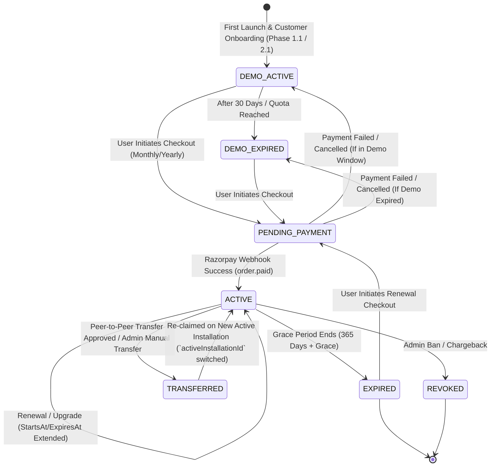
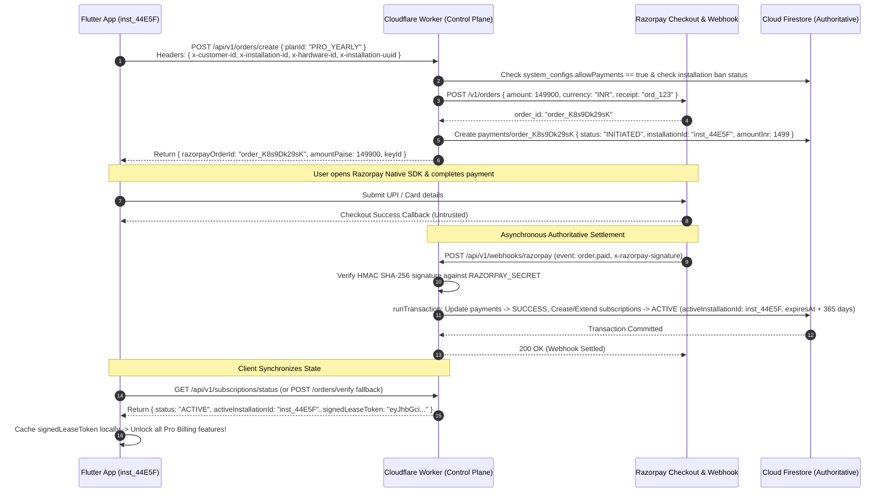
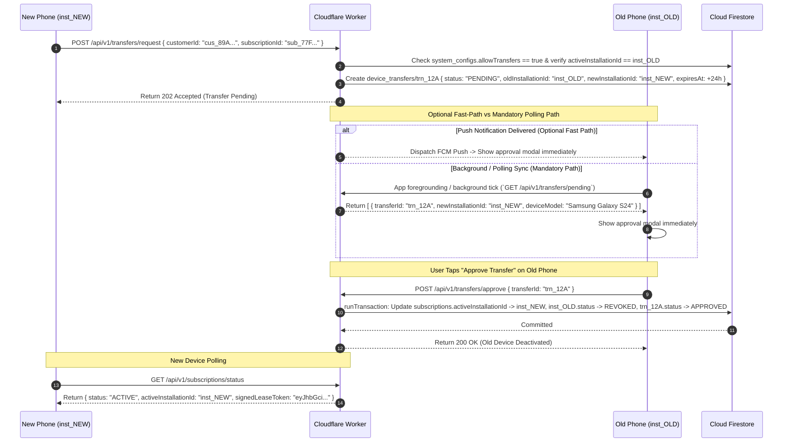

# Complete Payment Lifecycle & State Transition Blueprint (Version 1.0 Frozen)

## 1. Master Payment & Subscription State Machine

The entire lifecycle of a VendSoft subscription (`sub_xxxxxxxxx`) is governed by strict state transitions enforced exclusively by **Cloudflare Workers** in accordance with global `system_configs/global`. Enforcing the **One Active Device Rule**, every state transition checks and updates `activeInstallationId`.



---

## 2. Comprehensive Lifecycle Scenarios & Workflows (`Version 1.0 Frozen`)

### 2.1 Demo Tier Lifecycle (`DEMO_FREE` -> `DEMO_EXPIRED`)
1. **Onboarding**: On first launch (`allowRegistrations == true`), the vendor inputs `businessName`, `ownerName`, and `mobileNumber`. `POST /customers/register` creates `cus_xxxxxxxxx`, registers `inst_xxxxxxxxx`, and issues a 30-day `DEMO_FREE` subscription where `activeInstallationId = inst_xxxxxxxxx`.
2. **Entitlement Grant**: When `GET /subscriptions/status` is called by `inst_xxxxxxxxx`, the Worker returns the RSA/Ed25519 `signedLeaseToken`: `{ "planId": "DEMO_FREE", "activeInstallationId": "inst_xxxxxxxxx", "expiresAtEpochMs": createdAt + 30 days }`.
3. **Expiration**: Once `Date.now() > expiresAtEpochMs`, the app transitions to `DEMO_EXPIRED`. Billing tabs lock cleanly until a paid subscription is activated.

---

### 2.2 Standard Monthly (`PRO_MONTHLY`) & Yearly (`PRO_YEARLY`) Purchase


---

### 2.3 Renewal Lifecycle (Early & On-Time Renewals)
When an `ACTIVE` subscription (`PRO_YEARLY` expiring on `2026-12-31`) initiates a renewal on `2026-12-01`:
1. **Order Creation**: `POST /orders/create` generates a new Razorpay order bound to `activeInstallationId`.
2. **Authoritative Extension**: Upon receiving the `order.paid` webhook, inside `runTransaction`, the Worker inspects the existing `subscriptions` document:
   ```typescript
   const currentExpiresAt = existingSub.data().expiresAt.toMillis();
   const baseTime = currentExpiresAt > Date.now() ? currentExpiresAt : Date.now();
   const newExpiresAt = new Date(baseTime + plan.durationDays * 86400000);
   ```
3. **Outcome**: The new `expiresAt` is set to `2027-12-31` (adding exactly 365 days to the unexpired end date, ensuring zero lost days for early renewers).

---

### 2.4 Plan Upgrade (`PRO_MONTHLY` -> `PRO_YEARLY`)
If a vendor is 15 days into a 30-day `PRO_MONTHLY` subscription (`149 INR`) and decides to upgrade to `PRO_YEARLY` (`1499 INR`):
1. **Prorated Value Calculation**: The Worker calculates the remaining unused value of the current monthly plan:
   $$\text{Unused Value} = \text{Monthly Price} \times \frac{\text{Remaining Days}}{\text{Total Duration Days}}$$
2. **Order Adjustment**: When creating the Razorpay order for `PRO_YEARLY`, the Worker automatically applies a discount equal to the exact unused prorated value.
3. **Activation**: Upon payment capture, the old `PRO_MONTHLY` status is marked `SUPERSEDED`, and a new `PRO_YEARLY` subscription is activated for `activeInstallationId = inst_xxxxxxxxx` starting from `serverTimestamp()`.

---

### 2.5 Plan Downgrade (`PRO_YEARLY` -> `PRO_MONTHLY`)
1. **Deferred Transition**: The downgrade does not truncate active annual rights. The `subscriptions` record retains `planId: "PRO_YEARLY"` until `expiresAt`.
2. **Queued Subscription**: A secondary subscription document is created with `status: "QUEUED"` and `startsAt = currentSub.expiresAt`. On exact expiration date, the status transitions to `ACTIVE` under `PRO_MONTHLY`.

---

### 2.6 Payment Failure & User Cancellation (`FAILED` / `CANCELLED`)
1. **Checkout Dismissal**: If the user closes the Razorpay checkout modal (`onPaymentError`), the app calls `POST /orders/verify` with `errorCode: "PAYMENT_CANCELLED"`.
2. **Ledger Update**: The Worker updates `payments/{orderId}.status = "FAILED"`. The active or demo subscription state remains completely unchanged.
3. **Reconciliation Cron**: A scheduled Cloudflare Worker runs every 30 minutes, querying all `payments` where `status == "INITIATED"` older than 30 minutes, calling Razorpay API (`GET /v1/orders/{id}`) to mark abandoned records `FAILED`.

---

### 2.7 Network Failure & Retry Recovery (Idempotency in Action)
If a user pays via UPI and money debits, but mobile data drops instantly:
1. **Webhook Resilience**: Razorpay servers automatically retry webhook delivery (`POST /webhooks/razorpay`) up to 24 hours with exponential backoff (`5s, 30s, 5m, 1h...`). Cloudflare updates `payments -> SUCCESS` and `subscriptions -> ACTIVE`.
2. **Client Reconnection**: When the user opens the app on Wi-Fi, `GET /subscriptions/status` returns the active `signedLeaseToken` instantly.
3. **Manual Sync Button**: If the user taps "Check Payment Status" right after network recovery, `POST /orders/verify` (`x-idempotency-key`) checks Razorpay REST API directly, synchronizes Firestore, and unlocks the app instantly.

---

### 2.8 Duplicate Webhook Delivery Handling
If Razorpay delivers the `order.paid` webhook twice:
1. **First Delivery (`T0`)**: Worker verifies `status == "INITIATED"`, updates `status -> SUCCESS`, extends `subscriptions -> ACTIVE`, and returns `200 OK`.
2. **Second Delivery (`T0 + 500ms`)**: Worker enters `runTransaction`, reads `payments.status`. Seeing it is already `"SUCCESS"`, the transaction aborts write operations and exits cleanly with `200 OK ({ "processed": true, "note": "ALREADY_PROCESSED" })`. No double-extension occurs.

---

### 2.9 Refund Processing & Entitlement Revocation (`REFUNDED` / `REVOKED`)
1. **Admin Action**: Support Lead calls `POST /api/v1/admin/payments/refund`.
2. **Gateway Execution**: Worker calls Razorpay API (`POST /v1/payments/{paymentId}/refund`).
3. **State Revocation**: Inside `runTransaction`, Worker updates `payments -> REFUNDED` and updates `subscriptions -> REVOKED`.
4. **Client Lockout**: On next network check, the client receives `hasActiveSubscription: false` and purges its local lease.

---

### 2.10 Peer-to-Peer Device Transfer Workflow (`Optional Push / Mandatory Polling`)


---

### 2.11 Manual Admin Recovery Workflow (`Lost or Broken Phone Case`)
If the old device (`inst_OLD`) is lost, stolen, or physically destroyed (`0% polling possible`):
1. **Transfer Request**: The vendor installs VendSoft on their new phone (`inst_NEW`) and initiates a transfer request (`POST /transfers/request`). Because `inst_OLD` cannot approve, the request remains `PENDING`.
2. **Support Contact**: The vendor calls customer support and provides their `customerId` or `mobileNumber`.
3. **Admin Verification & One-Click Approval**: The Support Lead navigates to the **Admin Panel**, searches for `cus_xxxxxxxxx`, opens the pending transfer `trn_xxxxxxxxx`, verifies the vendor's identity via billing invoice details, and clicks **"Approve Manual Transfer"**.
4. **Authoritative Execution**: `POST /api/v1/admin/transfers/approve` executes the exact same atomic transaction: revokes `inst_OLD`, sets `activeInstallationId = inst_NEW`, marks `approvedBy = "ADMIN_MANUAL"`, and records the action in `audit_logs`. This is the **ONLY** manual recovery flow.
