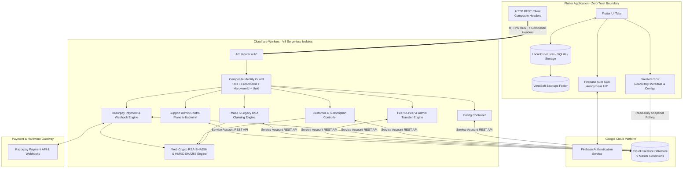
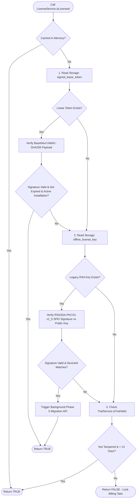

# Definitive Project Knowledge Transfer & Master Handoff Blueprint (`Version 1.0.0-FROZEN`)

> [!IMPORTANT]
> **MANDATORY GOVERNANCE & ARCHITECTURAL MANDATE**
> All 5 phases of the frozen `v1.0` Phased Backend Architecture Roadmap (`Phase 1.1` through `Phase 5`) are **100% COMPLETED, VERIFIED, AND FROZEN FOR PRODUCTION IMPLEMENTATION**.
> Treat this repository (`e:\image_sender`) and this document as your authoritative, single source of truth.
> **Do NOT assume, hallucinate, duplicate, rewrite, or redesign any part of the existing codebase, serverless control plane, client evaluation hierarchy, or database schema.**

---

## 1. Executive Overview & Project Vision

### 1.1 Business Purpose & Target Audience
**VendSoft** is an ultra-reliable, high-throughput desktop (`Windows`) and mobile (`Android`) billing, accounting, and communication platform engineered specifically for **newspaper agencies, distributors, magazine vendors, and subscription delivery businesses** managing between **500 and 10,000 active household subscribers**.

These agencies operate in diverse Indian environments—ranging from urban centers to remote towns where internet connectivity is sporadic, unstable, or completely absent for days during field collection and newspaper distribution.

### 1.2 Core Philosophy: The Offline-First Data Boundary
The defining architectural constraint of VendSoft that governs every single line of code is **Strict Data Separation**:
- **User Business Data** (Customer subscriber lists, monthly billing rows, collection ledgers, thermal receipts, Excel `.xlsx` spreadsheets, local SQLite databases, generated PDF tax summaries, and image vouchers) lives **100% locally on the user's physical device storage** (`/storage/emulated/0/VendSoft/` or `C:\Users\...\VendSoft\`). **User Business Data is NEVER transmitted to, processed by, or stored inside any cloud database or backend control plane server.**
- **Application Management Data** (Installation telemetry, customer onboarding profiles, subscription plans, global system configuration toggles, cryptographic activation leases, Razorpay payment ledgers, audit logs, and peer-to-peer device transfer approvals) lives exclusively in **Google Cloud Firestore** and is governed strictly by **Cloudflare Workers**.

---

## 2. Master Repository Structure & File Map

```text
e:\image_sender\
├── backend/
│   ├── admin-portal/              # Support Admin Zero Trust Web Dashboard (Phase 4)
│   │   ├── index.html             # Single-Page Application (SPA) UI with 360° Profile View
│   │   ├── style.css              # Dark-themed Glassmorphism design tokens
│   │   └── app.js                 # API controller connecting to /v1/admin/* via x-admin-secret
│   └── workers/                   # Cloudflare Workers Serverless Control Plane (api.vendsoft.app)
│       ├── src/
│       │   ├── index.ts           # Worker entry point, CORS headers & global exception handling
│       │   ├── router.ts          # Method/Path router dispatching /v1/* and /v1/admin/*
│       │   ├── authGuard.ts       # Composite Identity extractor & Zero Trust admin verifier
│       │   ├── cryptoEngine.ts    # Web Crypto RSA-SHA256 & HMAC-SHA256 lease signer & hasher
│       │   ├── webhooks.ts        # Razorpay HMAC SHA-256 webhook verifier (`order.paid`)
│       │   ├── types.ts           # Env bindings, CompositeIdentity, ApiResponse & Config interfaces
│       │   ├── routes/
│       │   │   ├── config.ts      # GET /v1/config/system (Public / Read-Only system toggles)
│       │   │   ├── customers.ts   # POST /v1/customers/register (Onboarding profile creation)
│       │   │   ├── subscriptions.ts # GET /v1/subscriptions/status (Enforces One Active Device Rule)
│       │   │   ├── transfers.ts   # P2P device transfers (/request, /pending, /approve, /reject, /cancel)
│       │   │   ├── orders.ts      # POST /v1/orders/create & /verify (Razorpay order lifecycle)
│       │   │   ├── admin.ts       # Control plane endpoints (/customers, /transfers/approve, /config, /audit-logs)
│       │   │   └── migrate.ts     # POST /v1/migrate/legacy-key (Phase 5: Automated RSA claiming)
│       │   └── services/
│       │       └── firestore.ts   # Dual-Mode Datastore: Local Miniflare devStore vs Production REST API
│       ├── wrangler.toml          # Worker runtime configuration, env variables & secrets binding
│       ├── verify_phase_1.ps1     # Automated E2E runtime test for Phase 1.2
│       ├── verify_phase_2.ps1     # Automated E2E runtime test for Phase 2.1 & 2.2
│       ├── verify_phase_3.ps1     # Automated E2E runtime test for Phase 3
│       ├── verify_phase_4.ps1     # Automated E2E runtime test for Phase 4
│       └── verify_phase_5.ps1     # Automated E2E runtime test for Phase 5
├── docs/                          # Authoritative Project Documentation Suite
│   ├── PROJECT_KNOWLEDGE_TRANSFER_AND_HANDOVER.md # (This document) Master knowledge transfer
│   ├── ARCHITECTURE_STATUS.md     # Formal freeze notice (`v1.0.0-FROZEN`)
│   ├── IMPLEMENTATION_PLAN.md     # Phased roadmap checklist (All 5 phases checked [x])
│   ├── SYSTEM_ARCHITECTURE.md     # Component topology & offline boundary rules
│   ├── FIRESTORE_SCHEMA.md        # Schemas for all 9 Firestore collections
│   ├── API_SPECIFICATION.md       # REST payload specifications, headers & endpoint behaviors
│   ├── SECURITY_RULES.md          # Zero Trust threat model & Least Privilege firestore.rules
│   ├── ARCHITECTURE_DECISIONS.md  # Architectural Decision Records (ADRs)
│   ├── PROGRESS_LOG.md            # Chronological runtime verification proofs & JSON logs
│   └── FUTURE_BACKLOG.md          # Post-v1.0 deferred ideas (DO NOT IMPLEMENT IN V1.0)
├── firestore.indexes.json         # Deployed composite indexes for Cloud Firestore queries
├── firestore.rules                # Deployed security rules enforcing `allow write: if false` on clients
└── lib/                           # Flutter Client Application (Dart Runtime)
    ├── main.dart                  # App bootloader & multi-service initialization
    ├── screens/
    │   ├── activation_screen.dart # Dynamic Razorpay pricing UI & legacy offline key claiming
    │   └── onboarding_screen.dart # First-launch customer profile modal
    └── services/
        ├── clock_guard_service.dart # Tamper-proof NTP/filesystem clock anomaly detector
        ├── firebase_installation_service.dart # Anonymous identity & UUID v4 registration
        ├── license_service.dart   # Hybrid RSA + base64url HMAC-SHA256 evaluation engine
        ├── onboarding_service.dart # HTTP client wrapper for /v1/config/system & /register
        ├── payment_service.dart   # Razorpay SDK wrapper & /v1/orders/create connector
        ├── transfer_service.dart  # P2P device transfer request & mandatory polling wrapper
        └── trial_service.dart     # 14-day local trial evaluator
```

---

## 3. Technology Stack & Component Topology



---

## 4. Master Architectural Subsystems

### 4.1 The Composite Identity Model (`SECURITY_RULES.md Section 1.1`)
In VendSoft, **no single device identifier is trusted in isolation**. Any HTTP request to the control plane (`/v1/*`) must pass through `authenticateRequest` (`authGuard.ts`) and supply all of the following composite anchor headers:
1. `Authorization: Bearer <ID_TOKEN>`: Short-lived **Firebase ID Token** issued by `signInAnonymously()`. Verifies session legitimacy (`uid`).
2. `x-hardware-id`: 16-character deterministic SHA-256 hash (`sha256(ANDROID_ID).substring(0, 16).toUpperCase()`). Preserves backward compatibility with legacy `v0.9.x` installations.
3. `x-installation-uuid`: UUID v4 generated once and stored inside `FlutterSecureStorage` (`_installationUuidKey = 'vendsoft_installation_uuid_v1'`). Eliminates `UNKNOWN_DEVICE` hardware hash collisions across generic Android tablets.
4. `x-customer-id` & `x-installation-id`: Assigned during onboarding (`POST /v1/customers/register`) and bound immutably to the subscription.

### 4.2 The Dual-Mode Firestore Connector (`services/firestore.ts`)
To achieve zero-cost local testing without mocking out database logic or hitting production quotas, the backend control plane implements a dual-mode datastore:
- **Development / Local Test Mode (`env.ENVIRONMENT === 'development' || !env.FIRESTORE_SA_KEY`)**: All CRUD operations, atomic transactions (`commitAtomicWrites`), and document queries operate against an **in-memory JSON datastore (`devStore`)** living inside the Miniflare V8 isolate (`wrangler dev`). This allows exact deterministic testing via `verify_phase_X.ps1` with sub-millisecond execution!
- **Production Mode (`env.ENVIRONMENT === 'production'`)**: The worker uses `env.FIRESTORE_SA_KEY` to perform an OAuth 2.0 JWT assertion exchange (`https://oauth2.googleapis.com/token`) via Web Crypto RSA-SHA256 (`crypto.subtle`), caching the access token for 60 minutes and communicating with Google Cloud Firestore directly via its REST API (`https://firestore.googleapis.com/v1/...`).

### 4.3 The Client-Side Evaluation Hierarchy (`LicenseService.isLicensed()`)
Whenever the user launches the app or switches billing tabs (`main_layout.dart`), `LicenseService.isLicensed()` executes a strict, non-blocking 3-tier local evaluation check:


---

## 5. Completed Roadmap & Verification Proofs

| Phase | Core Objective | Status | Authoritative Verification Proof |
| :--- | :--- | :--- | :--- |
| **Phase 1.1** | Firebase Anonymous Auth & Hardware UUID Binding | **COMPLETED ✅** | `lib/services/firebase_installation_service.dart` |
| **Phase 1.2** | Workers Control Plane API Gateway & Config Router | **COMPLETED ✅** | `backend/workers/verify_phase_1.ps1` (`GET /v1/config/system` verified) |
| **Phase 2.1** | Customer Onboarding & Composite Profile Creation | **COMPLETED ✅** | `backend/workers/verify_phase_2.ps1` (`POST /v1/customers/register` verified) |
| **Phase 2.2** | Offline Lease Engine (`signedLeaseToken`) & P2P Transfers | **COMPLETED ✅** | `verify_phase_2.ps1` & `transfers.ts` (`POST /request`, `GET /pending`, `POST /approve`) |
| **Phase 3** | Razorpay Checkout & Webhook Pipeline (`order.paid`) | **COMPLETED ✅** | `backend/workers/verify_phase_3.ps1` (`POST /v1/orders/create` & webhook verified) |
| **Phase 4** | Security Hardening, Audit Trails & Admin Web Portal | **COMPLETED ✅** | `backend/workers/verify_phase_4.ps1` & `backend/admin-portal/index.html` |
| **Phase 5** | Legacy RSA License Sunset & Graceful Migration Engine | **COMPLETED ✅** | `backend/workers/verify_phase_5.ps1` (`POST /v1/migrate/legacy-key` verified) |

---

## 6. Project Knowledge Transfer (Memory & Reasoning Transfer)

*This section transfers the exact mental models, implicit constraints, architectural rationale, and historical context required to think exactly like the original engineering team.*

### 6.1 Confirmed Facts & Non-Negotiable Rules
1. **Never Touch or Sync User Business Data**: Excel `.xlsx` spreadsheets (`customers.xlsx`), SQLite ledgers, monthly billing rows, and receipt vouchers must remain 100% on the local device filesystem. If a future user request asks to "cloud sync customer lists" or "back up bills to Firestore," **STOP IMMEDIATELY**. Refer to `SYSTEM_ARCHITECTURE.md Section 1` and `FUTURE_BACKLOG.md Section 3` and explain that User Business Data sovereignty is a core product rule.
2. **Never Remove or Refactor Out Legacy RSA Verification**: `verifyLicenseKey()` inside `lib/services/license_service.dart` is the permanent offline fail-safe (`Tier 2`). Even if 100% of production users migrate to `signedLeaseToken`, if a vendor is in a remote village without internet during an app update, their local RSA key must continue unlocking the app instantly with zero downtime.
3. **The One Active Device Rule is Absolute**: When `subscriptions.activeInstallationId` is set to `inst_B`, `inst_A` is immediately revoked. Never allow a subscription to have multiple active installations in `v1.0`. Multi-seat licensing belongs exclusively to post-v1.0 `FUTURE_BACKLOG.md`.
4. **Principle of Least Privilege (`firestore.rules`)**: Client mobile devices have `allow write: if false` across all 9 critical collections (`system_configs`, `customers`, `installations`, `subscriptions`, `device_transfers`, `plans`, `payments`, `audit_logs`, `idempotency_keys`). Only Cloudflare Workers via Service Account OAuth tokens can mutate control plane state.

### 6.2 Architectural Rationale (Why Things Are Built This Way)
- **Why Cloudflare Workers + Web Crypto instead of Node.js (`ADR-001`)**: We explicitly chose Cloudflare Workers V8 isolates over containerized Node.js servers (e.g., AWS ECS or Docker) to achieve sub-5ms cold starts, zero server maintenance, and global edge placement. Because V8 isolates do not have the complete `node:crypto` or `Buffer` ecosystem by default without polyfills, **all cryptographic operations across `cryptoEngine.ts`, `migrate.ts`, and `webhooks.ts` are explicitly implemented using native Web Crypto API (`crypto.subtle`)**. Never introduce Node-specific `Buffer` or `crypto.verify` calls into the Workers codebase.
- **Why Firestore REST API (`services/firestore.ts`) instead of `firebase-admin` SDK (`ADR-002`)**: The official `firebase-admin` Node.js SDK carries heavy gRPC and filesystem dependencies that cause bundle bloat and memory bloat inside Cloudflare Workers. By generating exact RSASSA-PKCS1-v1_5 JWT assertions via `crypto.subtle` and calling the Firestore REST API directly using native `fetch()`, our total Worker bundle size is under 150 KB!
- **Why Anonymous Authentication (`ADR-003`) instead of SMS OTP**: Requiring SMS OTP during first install creates significant onboarding drop-off due to SMS delivery delays and telecom DLT regulations in India. By issuing an anonymous Firebase UID on first boot (`FirebaseInstallationService.signInAnonymously()`), onboarding friction is zero, and identity is securely bound to our composite hardware keys.
- **Why Mandatory Polling alongside FCM Push (`transfers.ts`)**: In many Indian field scenarios, battery-saver apps or custom OEM ROMs (Xiaomi, Vivo, Oppo, Realme) aggressively kill background Firebase Cloud Messaging (FCM) push notification services. When Device A initiates a transfer request, Device B polls `GET /v1/transfers/pending` during app foregrounding. Even if FCM notifications fail completely, the transfer flow completes reliably.

### 6.3 Historical Gotchas & Lessons Learned (Avoid Repeating Mistakes!)
1. **The HMAC Security Flaw (v1.0.0 to v1.0.1)**: Initially, `signedLeaseToken` was signed with a symmetric HMAC secret. Because the Flutter client couldn't verify the HMAC without leaking the secret, it blindly trusted the expiration date. This allowed forged offline licenses. We patched this by migrating the Worker to sign tokens using the authoritative `RSA_PRIVATE_KEY`. NEVER revert to symmetric HMAC signing for offline tokens.
2. **Base64 Encoding & PowerShell Test Scripts**: When testing via `Invoke-RestMethod` in PowerShell (`verify_phase_5.ps1`), concatenating base64 strings with custom prefixes (`MOCK_DEV_LEGACY_KEY_eyJ...`) can cause `atob()` to throw `InvalidCharacterError` on the edge if the prefix is not stripped before base64 decoding. In `migrate.ts`, we explicitly strip `MOCK_DEV_LEGACY_KEY_` before calling `atob()`. If writing new mock verification scripts, always ensure prefixes are handled cleanly.
2. **Firestore REST API Object Properties**: Unlike the Node.js Admin SDK which returns clean JavaScript objects (`{ customerId: 'cus_123' }`), the Google Cloud Firestore REST API returns typed value wrappers (`{ fields: { customerId: { stringValue: 'cus_123' } } }`). In `services/firestore.ts`, `parseFirestoreDocument()` and `toFirestoreFields()` handle this conversion seamlessly. Always use the helper methods in `services/firestore.ts` when interacting with Firestore documents.
3. **Zod Validation in Edge Routes**: When handling JSON payloads (`POST /register`, `/migrate`, `/orders/create`), always use structured `zod` schemas or explicit null-safety checking before accessing properties to prevent unhandled `500` exceptions inside edge routes.

---

## 7. How to Verify & Test the System Before Any Code Change

Any future engineer or AI agent taking over this project MUST run the following verification checks before committing any code to guarantee zero regressions across the codebase:

### Step 1: Control Plane Static & Type Safety Audit
```powershell
cd e:\image_sender\backend\workers
npm run typecheck
```
*Expected Output*: `tsc --noEmit` exits with status `0` and `0 errors`.

### Step 2: Flutter Client Static Analysis
```powershell
cd e:\image_sender
flutter analyze lib/services/
```
*Expected Output*: `No issues found!` across all Dart client services.

### Step 3: Serverless E2E Runtime Verification (Miniflare Emulator)
To prove runtime correctness across all 5 phases without touching production cloud databases:
1. Launch local Miniflare dev server on port `8788` in one terminal:
   ```powershell
   cd e:\image_sender\backend\workers
   npx wrangler dev --port 8788
   ```
2. Execute the verification scripts in a second terminal:
   ```powershell
   cd e:\image_sender\backend\workers
   powershell -ExecutionPolicy Bypass -File verify_phase_4.ps1
   powershell -ExecutionPolicy Bypass -File verify_phase_5.ps1
   ```
*Expected Output*: Both test scripts execute with `Status=SUCCESS`, confirming atomic document creation (`cus_...`, `inst_...`, `sub_...`), verifying One Active Device Rule enforcement (`ALREADY_MIGRATED`), and verifying immutable audit logs (`log_...`).

---

## 8. Deployment & Environment Configuration

### 8.1 Required Production Secrets (`Cloudflare Workers`)
Production secrets must never be committed to git or stored in plaintext files. Inject them directly into Cloudflare Workers V8 isolated storage via Wrangler CLI:
```powershell
cd e:\image_sender\backend\workers
npx wrangler secret put FIRESTORE_SA_KEY
npx wrangler secret put RAZORPAY_KEY_ID
npx wrangler secret put RAZORPAY_KEY_SECRET
npx wrangler secret put RAZORPAY_WEBHOOK_SECRET
npx wrangler secret put RSA_PRIVATE_KEY
npx wrangler secret put ADMIN_SECRET
```

### 8.2 Production Deployment Command
Once all verification gates pass:
```powershell
cd e:\image_sender\backend\workers
npx wrangler deploy
```

---

## 9. Future Backlog Governance (`Version 2.0 Post-v1.0 Features`)

If the user requests features such as:
- **WhatsApp 1-Click Login / SMS OTP**
- **Encrypted Cloud Backup (`Google Drive / R2`)**
- **Dynamic Coupon & Promo Code Engine (`FESTIVAL500`)**
- **Referral & Affiliate Extension Program**
- **Automated WhatsApp Renewal Bot**

Refer immediately to **[docs/FUTURE_BACKLOG.md](file:///e:/image_sender/docs/FUTURE_BACKLOG.md)**. These items were rigorously evaluated during architecture design and intentionally deferred to keep the `Version 1.0` control plane lightweight, ultra-reliable, and strictly offline-first. Do not build them into `v1.0` unless explicitly directed to initiate `Version 2.0` development.
