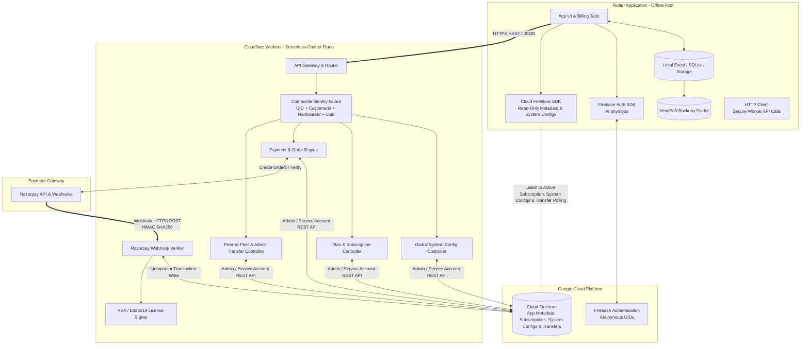
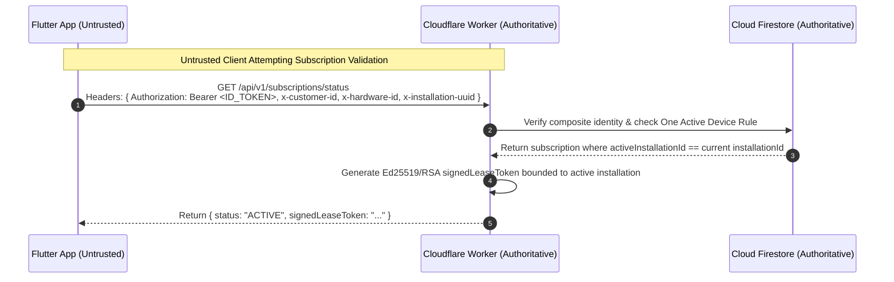
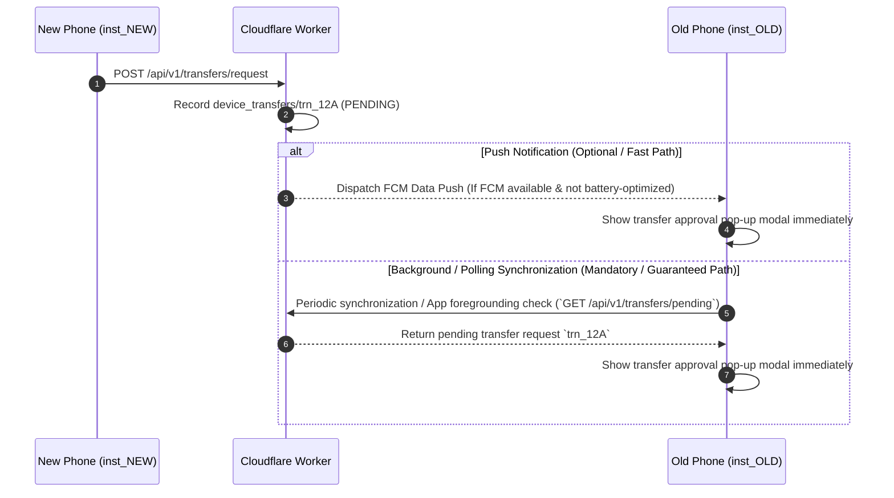

# VendSoft Backend System Architecture Blueprint (Version 1.0 Frozen)

## 1. Executive Summary & Core Philosophy

VendSoft is an offline-first, high-throughput desktop/mobile billing and communication platform built with Flutter. The application serves newspaper agencies, distributors, and subscription-based vendors managing between 500 and 10,000 customers.

The primary architectural mandate is strict operational separation between **User Business Data** and **Application Management Data**:
- **User Business Data** (Customer lists, monthly bills, payment ledgers, thermal receipts, Excel databases, PDF exports, and image vouchers) lives **100% locally on the device** (and user-managed local backups). It is **NEVER** transmitted to, processed by, or stored in any cloud database or backend server.
- **Application Management Data** (Installation telemetry, customer onboarding profiles, subscription status, plan definitions, global system configurations, cryptographic activation keys, payment ledgers, audit logs, and device transfer approvals) lives entirely in **Google Cloud Firestore** and is governed strictly by **Cloudflare Workers**.

---

## 2. Master System Architecture & Component Responsibilities



### Component Responsibilities

| Component | Technology | Primary Responsibilities | Trust Level |
| :--- | :--- | :--- | :--- |
| **Client Application** | Flutter (Dart) | Manages local UI, customer billing, WhatsApp dispatch, thermal ESC/POS printing, and local Excel/file storage. Reads Firestore (`system_configs/global`, active plans, pending transfer requests). Calls Cloudflare Workers to initiate customer registration, payments, and peer-to-peer transfers. | **Untrusted (Zero Trust)** |
| **Control Plane** | Cloudflare Workers (V8 Serverless JS/TS) | Acts as the sole authoritative enforcement boundary. Validates anonymous tokens, enforces the **Composite Identity Model**, enforces the **One Active Device Rule**, manages **Global System Configurations**, communicates with Razorpay, handles idempotency, processes peer-to-peer device transfers, and issues signed activation tokens. | **Authoritative (Full Trust)** |
| **State Layer** | Cloud Firestore | Stores immutable `customerId` records, hardware installations, customer plans, active subscriptions (`activeInstallationId`), **global system configurations (`system_configs/global`)**, payment history, peer transfer requests, and audit logs. Accessed read-only by clients via strict Security Rules; written solely by Cloudflare Workers. | **Authoritative (Full Trust)** |
| **Identity Engine** | Firebase Auth | Issues unique, persistent Anonymous User IDs (`UID`) to devices upon initial startup without requiring mandatory SMS/Email friction. | **Authoritative (Full Trust)** |
| **Payment Processor**| Razorpay | Processes payments (UPI, Cards, NetBanking). Generates cryptographic webhooks (`x-razorpay-signature`) upon successful payment capture. | **External Authoritative** |

---

## 3. Global System Configuration Architecture (`system_configs`)

To ensure centralized operational control without requiring app store updates or client code changes, the backend maintains a global configuration object inside `system_configs/global` in Firestore (exposed via `GET /api/v1/config/system`).

### 3.1 Server-Controlled Configuration Object
```json
{
  "minimumSupportedVersion": "1.0.0+1",
  "latestVersion": "1.0.2+3",
  "maintenanceMode": false,
  "maintenanceMessage": "VendSoft servers are undergoing scheduled maintenance. Offline billing continues normally. Cloud updates will resume in 30 minutes.",
  "allowRegistrations": true,
  "allowPayments": true,
  "allowTransfers": true,
  "updatedAtEpochMs": 1752672000000
}
```

### 3.2 Governance & Client Behavior Mandates
- **Exclusive Backend Ownership**: These values are managed strictly by Cloudflare Workers and the Admin Panel. **The Flutter client application must ONLY read them. The Flutter client application must NEVER change or write them (`Allow write: if false` in `firestore.rules`).**
- **Enforcement Rules on Flutter App Launch / Resume**:
  1. **Force Update Check**: If `currentAppVersion < minimumSupportedVersion`, the app displays a non-dismissible modal directing the user to the Play Store or download portal while preserving local backup access.
  2. **Maintenance Mode Lock**: If `maintenanceMode == true`, cloud actions (registration, checkout, transfer requests) are disabled with `maintenanceMessage`. Local offline billing (`Excel / SQLite`) continues operating with 100% autonomy.
  3. **Feature Switches**: If `allowRegistrations == false`, onboarding screens hide registration buttons. If `allowPayments == false`, checkout buttons disable gracefully. If `allowTransfers == false`, transfer initiation buttons lock.

---

## 4. The Trust Model & Zero-Trust Boundary

The fundamental security rule of VendSoft is: **Never trust the Flutter application, never trust the device clock, never trust unverified client payment assertions, and never consider Business Name or Mobile Number alone as proof of device ownership.**



---

## 5. The Composite Customer & Device Identity Model

To eliminate spoofing without relying on paid SMS verification, VendSoft implements a multi-anchor composite identity model:

```mermaid
graph LR
    Sub[Subscription Record<br/>sub_xxxxxxxxx] -->|activeInstallationId| Inst[Installation Record<br/>inst_xxxxxxxxx]
    Inst -->|Belongs to| Cust[Customer Profile<br/>cus_xxxxxxxxx (Immutable)]
    Inst -->|Anchored by| HW[Hardware ID<br/>LicenseService.getDeviceId()]
    Inst -->|Anchored by| UUID[Installation UUID<br/>FlutterSecureStorage]
    Inst -->|Anchored by| FUID[Firebase Auth UID<br/>Anonymous User]
```

---

## 6. One Active Device Rule & Transfer Notification Strategy

### 6.1 One Active Device Rule
Every paid subscription (`sub_xxxxxxxxx`) is strictly bounded to **ONE ACTIVE INSTALLATION** at any given second (`activeInstallationId`). Even if a customer registers 5 devices under `cus_xxxxxxxxx`, only the single installation matching `activeInstallationId` receives a valid `signedLeaseToken`. All other installations receive `status: "INACTIVE_SUPERSEDED"` and operate in read-only/demo-locked mode.

### 6.2 Transfer Notification & Polling Strategy (`Version 1.0 Frozen`)
When a vendor requests a peer-to-peer device transfer from a new phone (`inst_NEW`), the old phone (`inst_OLD`) must authorize the request. To guarantee operational reliability across diverse Android hardware and battery-optimization profiles, the architecture treats **Push Notifications (Firebase Cloud Messaging - FCM) as strictly OPTIONAL**:



#### Why Push Notifications Are Optional:
- **Zero Notification Dependency**: Transfer approval **MUST NOT** depend on push notifications. In rural India, aggressive OEM battery savers (`Xiaomi MIUI`, `Realme UI`, `Vivo Funtouch`) frequently kill FCM background listeners or delay push delivery for hours.
- **Guaranteed Synchronization Path**: Whether FCM is delivered or completely disabled, `inst_OLD` automatically queries `GET /api/v1/transfers/pending` whenever the app returns to the foreground (`didChangeAppLifecycleState`), or via background synchronization ticks. This ensures 100% transfer completion reliability without requiring mandatory push notifications.
- **Lost or Broken Phone Recovery**: If `inst_OLD` is lost, stolen, or broken (`0% polling possible`), the vendor contacts support and an Admin approves the transfer via Admin Panel (`POST /admin/transfers/approve`). This is the **ONLY** manual recovery flow.
